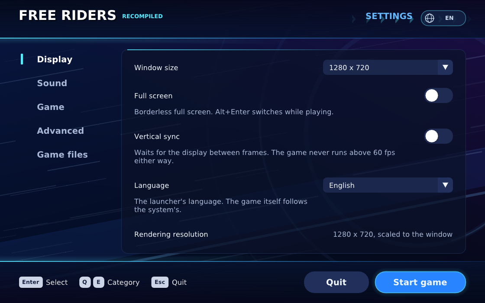
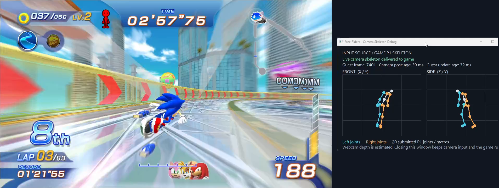
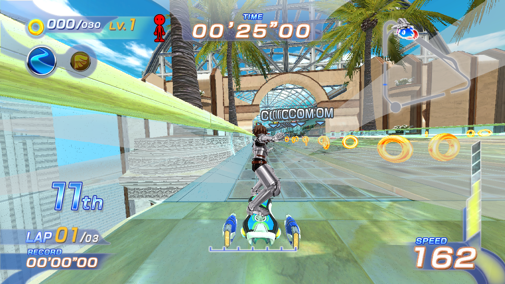
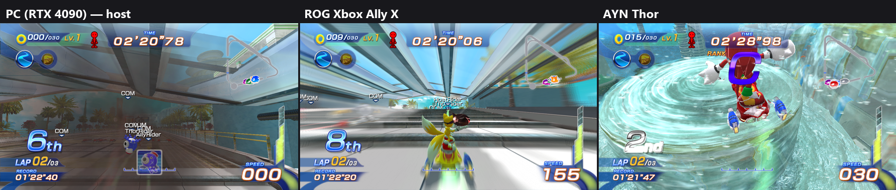

# Free Riders Recompiled

[English](README.md)

Free Riders Recompiled 是以靜態重編譯製作的 Xbox 360 版《Sonic Free Riders》非官方移植，
支援 Windows、Linux 與 Android。可使用手把或鍵盤遊玩，也能在 **Windows 上使用 Kinect／
Kinect v2 或一般攝影機進行體感操作**，並匯入自己的 **VRM 模型**作為遊戲內的 AVATAR 角色。
Kinect v2 目前屬實驗性支援，仍待實機驗證。

遊戲的 PowerPC 程式碼經
[XenonRecomp](https://github.com/hedge-dev/XenonRecomp) 轉成 C++，Xenos 著色器經
[XenosRecomp](https://github.com/sonicnext-dev/XenosRecomp) 轉換，再由原生執行期代替主機的
核心、繪圖、音效、輸入與 Kinect。

**本專案不包含任何遊戲素材。遊玩需要你自己合法取得的遊戲（美版／歐版光碟）：**啟動器會從
你的光碟映像檔安裝遊戲資料。預先建置的版本在
[Releases](https://github.com/YuutaTsubasa/Free-Riders-Recompiled/releases) 頁面；想自己建置，
見[建置說明](docs/building.md)（英文）。

> [!IMPORTANT]
> 仍在開發中。遊戲可以啟動、選單可以操作、比賽可以遊玩，但許多部分尚未測試，可能會停止或
> 出現異常。



## 目前狀態

已經可以：

- 從標題畫面經選單進入比賽：Free Race 從開始到結算；Grand Prix 從劇情進入第一場比賽。
- Direct3D 12 與 Vulkan 繪圖，著色器在遊戲遇到時即時轉換；音效；紀錄的儲存與讀取。
- 不需要 Kinect：Kinect 由程式模擬。按鍵代替選單能聽懂的語音指令，手把驅動比賽讀取的
  身體動作（傾斜、跳躍、踢地加速、抓取、特技）。
- Windows 支援實體 Kinect 與 Kinect v2，將感測器追蹤的骨架交給遊戲。
  Xbox 360 版 Kinect 已實際跑完比賽；Kinect v2 仍屬實驗性支援。
  詳見下方的 [Kinect 與 Kinect v2](#kinect-與-kinect-v2)。
- 各平台都有啟動器：從光碟映像檔安裝遊戲並保存設定，支援英文與繁體中文（右上角可切換）。
- Linux（Vulkan、SDL2），以及 Android（arm64-v8a）的觸控按鈕與傾斜轉彎。
- Windows 可選擇使用 webcam 控制 1P：估算 3D 骨架、手把自動接手，以及獨立骨架 Debug 視窗。
- 實驗性 VRM Avatar 模型：可在啟動器選擇自己的模型，搭配遊戲動畫與手持道具。
- HedgeModManager 格式的檔案替換模組，在啟動器的「模組」分頁管理（[Mods](docs/mods.md)）。

已知限制：

- 只支援美版／歐版光碟。
- 遊戲大部分內容尚未完整遊玩過；上述以外的關卡與模式可能停在執行期還沒做到的地方。
- Linux 與 Android 使用事先在 Windows 上轉換好的著色器（`shaders.pack`，發布版已附）。遊戲會
  在開機時建立著色器；發布版已附上相容的著色器包。
- Android 已在模擬器與一台 Adreno 750 掌機上試過。

開發紀錄在 [docs/](docs/)，從 [docs/progress.md](docs/progress.md) 開始。

## 系統需求

- **Windows**：Windows 10 或 11（x64），支援 AVX 的 CPU，支援 Direct3D 12（或 Vulkan 1.2）的
  顯示卡。
- **Linux**：支援 AVX 的 x86-64 與 Vulkan 1.2 驅動程式（在 Ubuntu 22.04 上測試）。
- **Android**：Android 9 以上、arm64-v8a、Vulkan 1.1；安裝需約 2 GB 可用空間。
- 建置所需工具見 [docs/building.md](docs/building.md)。

## 安裝

1. 從 [Releases](https://github.com/YuutaTsubasa/Free-Riders-Recompiled/releases) 下載對應系統
   的版本：Windows 的 zip、Linux 的 tar.gz，或 Android 的 APK。
2. 解壓縮到一個獨立的資料夾（Android 則安裝 APK）。
3. 執行 `FreeRidersRecompiled`，在啟動器要求時選擇你的光碟映像檔（`.iso`），它會把遊戲資料
   複製到旁邊。然後按 **開始遊戲**。在 iOS 上也可以用「檔案」App 把 `.iso` 放進
   **我的 iPhone › Free Riders**，啟動器會在那裡找到它。

## 設定分類

啟動器依照用途分成九類：

| 分類 | 設定內容 |
| --- | --- |
| 一般 | 啟動器語言、遊戲語言、語音語言、影片、還原設定 |
| 畫面與效能 | 顯示模式（無邊框或視窗，預設無邊框）、視窗解析度、畫面比例與介面對齊、繪圖後端、渲染尺寸、垂直同步、可展開的進階效能選項 |
| 音效 | 遊戲音量、啟動器提示音 |
| 控制器與按鍵 | 各玩家的輸入來源與手把、按鍵綁定、Android 觸控與傾斜操作 |
| 體感與攝影機 | Kinect／攝影機模式、裝置與預覽、鏡像、骨架 Debug、語音指令 |
| Avatar 模型 | 加入自訂 VRM／GLB 模型並選擇要使用的一個 |
| 模組 | 啟用或停用檔案替換模組，並調整順序（[Mods](docs/mods.md)） |
| 成就 | 遊戲的 50 個成就：哪些已解鎖、何時解鎖，附圖示與成就點數 |
| 遊戲檔案 | 安裝、資料位置與 Shader Pack |

**成就** 列出每個成就的圖示、名稱、說明、成就點數與解鎖日期，以及總計（例如 2 / 50、25 / 1000 G）。
遊戲會像在主機上一樣頒發成就，不需要 Xbox 網路：每個成就跟玩家的存檔放在一起（玩家存檔資料夾裡的
`achievements.txt`，見[存檔](docs/saves.md)），更新版本也不會遺失。名稱、說明與圖示讀自已安裝遊戲本身的
標題資料，遊戲光碟有該語言時使用遊戲語言，否則為英文（光碟沒有中文）。需要累積次數的成就（Bomb-Happy 的
魚雷命中 30 次、16 場第一、10,000 個 Ring、跑遍某模式的所有賽道等）會顯示目前進度，讀自遊戲本身的存檔。
**成就通知**（預設開啟）會在遊戲中顯示主機的「Achievement unlocked」通知。

**畫面與效能** 最上方是 **顯示模式**：**無邊框**（預設）填滿整個螢幕，**視窗** 則使用其下方選擇的視窗解析度
（視窗解析度僅在視窗模式顯示）。
**渲染尺寸**位於**繪圖後端**正下方。**原始**（預設）與以前每一版相同，不論視窗或螢幕多大都以遊戲本身的 720 線繪製；
其他選項是相對於視窗大小（無邊框模式時為螢幕解析度）的解析度比例，可在 0.25x 到 3.0x 之間以 0.25x 為單位調整。
1.0x 與視窗／桌面解析度完全相同；較低值可減輕 GPU 負擔，較高值以超取樣讓畫面更銳利（每邊上限 8192 像素）。
**銳利縮放**（預設關閉）把比視窗小的畫面以重複像素的方式放大，不做模糊平滑；超取樣的畫面仍會平均縮小。
舊版設定檔的 `render_scale` 會換成目前視窗下最接近的選項。遊戲設定於下次啟動遊戲時套用，
詳見[內部解析度](docs/internal-resolution.md)（英文）。
視窗解析度清單的最後一項「自訂」會顯示寬度與高度輸入框，可輸入每邊 160 到 16384 像素的任意大小。

視窗解析度在選擇其他尺寸之前預設為桌面大小。

視窗解析度清單包含系統回報的顯示模式，再加上常用尺寸與桌面大小；其他尺寸會顯示為「自訂」。
設定檔的 `fullscreen` 維持原意（1 為無邊框、0 為視窗）；沒有此項的設定檔現在預設為無邊框。

視窗解析度清單另外提供常見的超寬尺寸（2560 x 720、2560 x 1080、3440 x 1440、5120 x 1440）。
同一區還有兩個選項：

- **畫面比例**（`aspect_ratio`）：**自動**（Windows 與 Linux 的預設，英文 Auto）依視窗或螢幕形狀
  調整畫面；**原始**（英文 16:9，Android 的預設，較寬的畫面會降低手機的幀率）維持遊戲原本的 16:9 畫面。
  雙人比賽也會變寬：分割比賽的左右兩半、Tag Race 牽手時、雙人的 On your Gear 都填滿畫面，
  兩位玩家的 HUD 各自貼在自己那一側（`SFR_TWO_PLAYER_WIDE=0` 則維持 16:9 並在兩側加黑邊）。兩者皆保留所選的輸出解析度。
  選「自動」且視窗（全螢幕時為螢幕）比 16:9 更寬時，比賽 3D 畫面會加寬（hor+），
  比賽 HUD 維持在中央的 16:9 區域，選單、標題與校正畫面的背景填滿整個寬度，
  影片維持 16:9 並加上黑邊。選「原始」時維持遊戲原本行為不介入。
- **介面對齊**（`ui_align`）：**外緣**（預設，英文 Edge）把比賽 HUD 的左右群組
  放在螢幕邊緣；**中央**（英文 Center）讓 HUD 集中在畫面中央。
  僅在比例為「自動」時顯示；選「原始」時此列隱藏，維持遊戲原本行為不介入，並保留原本的對齊選擇。選單內容維持置中。

啟動器設定 `SFR_ASPECT_MODE` 與 `SFR_UI_ALIGN`，清除 `SFR_ASPECT_RATIO`，
並直接傳入使用者選擇的視窗尺寸。舊版設定檔的 `aspect_mode=original` 會視為原始 16:9。
變更於下次啟動遊戲時套用。

## 建置

Windows 的簡短步驟：

```powershell
python scripts/bootstrap.py
./scripts/build_tools.ps1
python scripts/rom_tool.py extract --iso "你的光碟.iso" --output private/game --path default.xex
python scripts/prepare_recomp.py
./scripts/build_shader_translator.ps1
./scripts/build_tools.ps1 -Diagnostic
./out/build/host/FreeRidersRecompiled.exe
```

第一次執行時，啟動器會要求選擇光碟映像檔，並把遊戲安裝在它旁邊。Linux 與 Android 的建置，
以及每一步的作用，見 [docs/building.md](docs/building.md)；平台細節見
[docs/linux.md](docs/linux.md)、[docs/android.md](docs/android.md)。

## 操作

| 動作 | 鍵盤 | 手把 |
| --- | --- | --- |
| 選單：移動／轉動選單圓環 | 方向鍵 | 十字鍵 |
| 確定（說「OK」） | Z 或空白鍵 | A／✕ |
| 返回 | Esc、X 或 Backspace | B／○ |
| BACK | Tab | BACK／Share |
| 開始、暫停 | Enter | START |
| 比賽：傾斜轉彎 | 方向鍵 | 左類比 |
| 蹲下（按住）、跳躍（放開） | Z 或空白鍵 | A |
| 踢地加速 | C | X |
| 煞車、抓取 | X | B |
| 切換站姿 | V | Y |
| 使用／搖晃道具 | F | RT |
| 力量型招式（左／右出拳） | Q／E | LB／RB |
| 飛行型招式：上升（按住）、下降（放開） | Z 或空白鍵 | A |
| 牽手（Tag Race，兩位玩家都按住） | R | LT |
| 換下一位選手（Relay Race） | Z 或 Tab | A 或 BACK |
| 手部游標（只認 Kinect 的選單） | I J K L | 右類比 |
| 成就頁面（打開／關閉） | F1 | L3 + R3（同時按下兩個類比搖桿） |

Xbox 與 PlayStation 手把都能使用。Android 沒有連接手把時，畫面上的半透明觸控按鈕提供相同的
操作，比賽中也能左右傾斜手機轉彎。比賽以外，用手指點按鈕以外的地方，Kinect 手部游標就移到那裡
（和用手一樣停留一下就選取）；標題畫面點一下等於 START。電腦上滑鼠也能這樣移動手部游標。

**成就頁面** 在遊戲中列出全部 50 個成就與進度（比賽中會像主機的 Guide 一樣暫停）；十字鍵或方向鍵選擇，
LB／RB 或 Page Up／Down 翻頁，B 或 Esc 關閉。觸控螢幕上點「Achievement unlocked」通知或三指輕點即可打開，
拖曳捲動，點頁面外關閉。詳見 [docs/achievements.md](docs/achievements.md)。

## Kinect 與 Kinect v2

Windows 版支援實體 **Kinect v1** 與 **Kinect v2** 感測器的身體追蹤。
Kinect 為選用功能；使用手把或鍵盤遊玩，不需要感測器，也不必安裝 Kinect SDK。

| 感測器 | 所需設備與軟體 | 目前狀態 |
| --- | --- | --- |
| Xbox 360 版 Kinect／Kinect for Windows 第一代 | SDK 1.8 與供電 USB 連接；Xbox 360 版需完整 SDK，Kinect for Windows 第一代可用 Runtime 1.8 | 已在 Windows 10 上用 Xbox 360 版 Kinect 實際跑完比賽 |
| Kinect v2／Xbox One 版 Kinect | SDK 2.0、USB 3.0 與相容的 PC 電源轉接器 | 實驗性支援；已實作骨架追蹤，仍待實機遊玩驗證 |

安裝對應 SDK 並連接感測器後，在啟動器的 **體感與攝影機 → 攝影機** 設定選擇 **Kinect（Xbox 360）** 或
**Kinect v2（Xbox One）**，再按 **開啟預覽** 確認追蹤狀態。兩個選項各自只開對應的那一代，
兩種感測器都接上時可指定要用 v2。舊的 `settings.ini`（`camera=kinect`）若只接了 v2 仍可使用：
找不到 Xbox 360 版時會改用 v2，`game.log` 會註明。「平滑」選項已移除：遊戲會照原版要求 Kinect 函式庫的濾波器與參數，
把實體 Kinect（v1 與 v2）的骨架平滑一次。
Kinect v2 一律把自己的深度換成 Kinect v1 格式的深度影像交給遊戲。跟主機一樣，Kinect 的比賽輸入
永遠來自遊戲自己的判斷器：傾身、蹲下、跳躍讀深度影像（蹲下與跳躍也讀骨架的髖部），其他動作與選單讀骨架，
電腦端沒有任何替代判定；深度打不開時遊戲就沒有深度，
`game.log` 與 launcher 的 Kinect 預覽會說明原因。
請讓全身進入感測器範圍，並預留足夠的活動空間。

Kinect v1 可提供骨架、深度與彩色影像；v2 交給遊戲的有骨架與由自身深度換算的深度影像；v2 的彩色與深度影像會顯示在 launcher 的預覽視窗（尚未實機驗證）。實體 Kinect 輸入僅支援 Windows，Linux 與 Android 發行包尚未提供。

SDK 下載、轉接器需求與疑難排解見 [Kinect 感測器使用說明](docs/kinect-sensor.md)。
若要使用一般攝影機進行體感操作，請看下一節。

## 攝影機體感



*從同一幀錄影裁切並排的遊戲與骨架畫面。Debug 視窗以正面與側面視角顯示實際交給遊戲的
關節，不顯示攝影機影像。*

Windows 發行包已內附體感模型與執行庫。在啟動器選擇 **體感與攝影機 → 攝影機 → 體感**，
並讓全身進入鏡頭範圍。可另外開啟 **骨架 Debug 視窗**，查看遊戲收到的骨架正面與
側面視圖；視窗不顯示攝影機影像。

攝影機控制 1P，操作手把時由手把優先接手；手把閒置 1.5 秒且仍有有效追蹤時，才回到
體感。失去追蹤時仍可用手把操作。單人遊玩可將 2P 輸入設為 **關閉**。

姿勢推論在本機執行，使用 [ONNX Runtime](https://github.com/microsoft/onnxruntime)
1.30.0（MIT），搭配 [OpenCV Zoo 的 MediaPipe 姿勢模型](https://github.com/opencv/opencv_zoo/tree/47534e27c9851bb1128ccc0102f1145e27f23f98/models/pose_estimation_mediapipe)
與[人物偵測模型](https://github.com/opencv/opencv_zoo/tree/47534e27c9851bb1128ccc0102f1145e27f23f98/models/person_detection_mediapipe)
（Apache 2.0）。模型源自 Google MediaPipe，本專案使用其 ONNX 轉換版本，
不需要安裝 MediaPipe 或 OpenCV 執行庫。下載檔的 SHA-256 固定於
[scripts/fetch_pose_model.py](scripts/fetch_pose_model.py)，Windows 與 Linux 發行包的 `licenses/`
資料夾內附授權與第三方通知。

單眼攝影機估算的是相對 3D 姿勢，並非 Kinect 的深度量測。Android APK 也附上同樣的
模型與執行庫，可以用手機自己的鏡頭（第一次開鏡頭時詢問相機權限；沒有鏡頭的裝置不會被
問），授權附在 APK 旁的授權壓縮檔。Linux 的 tar.gz 也附上，透過 V4L2 讀取 webcam。設定、動作說明與自行建置方式見[攝影機體感輸入](docs/camera-input.md)。

## VRM Avatar 模型

從 v0.3.0 起，可用自己的 **VRM 0.x／VRM 1.0** 模型替換遊戲內的 **AVATAR** 角色。
不需要開啟攝影機體感，手把與鍵盤也可以操作。



*以自訂 VRM 模型替換遊戲內的 AVATAR 角色。*

1. 開啟啟動器的 **Avatar 模型** 分頁。
2. 按 **加入模型...**，選擇 `.vrm` 或二進位 `.glb` 檔。桌面版也可直接輸入路徑；Android 會將
   模型複製到 app 的儲存空間。加入過的模型會留在清單中，之後可以直接切換。
3. 啟動遊戲，在角色選單選擇 **AVATAR**，再選 Gear。存檔需已能選擇 AVATAR；設定模型
   不會自動解鎖角色。
4. 回到啟動器選擇其他模型後重新啟動遊戲即可更換；選 **不使用自訂模型** 可停用，
   按 **移除** 可把模型從清單拿掉。

1P／2P 共用一個模型設定，由遊戲內誰選擇 AVATAR 決定套用對象，各自保留動作姿勢。
其他角色不受影響。模型會出現在 Loading 與比賽中，跟隨遊戲的主要身體動畫、跳躍與
換邊動作，手持道具也會使用 VRM 的手部位置。模型只在本機讀取，發布包不附模型，
也不會上傳你的模型。

目前仍屬實驗性功能。沒有 VRM 人形骨架的 `.glb` 會保持靜態；尚未實作完整 MToon、
透明混合、彈簧骨骼、表情與手指動畫。不同模型的姿勢與道具握持位置可能有差異，
高精細模型也可能降低效能。已檢查 Windows D3D12／Vulkan 遊玩；完整雙人 VRM 與
Linux／Android 實機 VRM 遊玩仍待更多測試。

平台細節與疑難排解見 [VRM Avatar 使用說明](docs/vrm-avatar.md)（英文）。

## 線上對戰

從 v0.7.0 開始，遊戲的 **Xbox LIVE** 模式可以再次使用了：改由本專案提供的伺服器取代微軟的
伺服器，支援 Create Match、Quick Match、大廳與線上比賽。Windows、Linux 與 Android 的玩家
可以一起比賽。



*同一場線上比賽：PC（主機）、ROG Xbox Ally X 與 AYN Thor。*

1. 每台裝置：**啟動器 → 一般 → 線上遊玩 → Xbox LIVE**。
2. **一台裝置當主機**：開啟 **由這台裝置當伺服器**。遊戲本身會在 TCP 與 UDP 連接埠 47800 執行
   伺服器。Windows 第一次會詢問是否讓遊戲通過防火牆，請在私人網路上允許；Android 不需要設定。
3. **其他裝置連線**：在 **伺服器位址** 輸入主機的區域網路 IP（例如 `192.168.1.10`），每位玩家
   的 **線上名稱** 要不同。存檔與設定檔不受影響。主機可以在 **密碼** 設定房間密碼，其他人輸入
   相同的密碼才能加入（密碼未加密傳送，請勿使用其他地方的密碼）。
4. 進入遊戲後開啟 **主選單 → Xbox LIVE**。主機選 **Create Match**；其他人選 **Quick Match**，
   在找到的大廳上按 **A**。由主機開始比賽。

已在家用網路測試：三台裝置同一場比賽、主機是 PC 或 AYN Thor、有玩家中途離開。透過網際網路
對戰需要把 47800 連接埠轉送到主機，這部分還沒測試。排行榜、Xbox LIVE Party 與語音聊天
不支援；成就保存在本機（見[設定分類](#設定分類)）。

**和遠方的朋友一起玩：** 不想轉送連接埠的話，可以把伺服器放到雲端（VPS 或免費的雲端 VM）。
每次發布版本都會提供 Docker 映像檔 `ghcr.io/yuutatsubasa/free-riders-server`；所有玩家輸入
那台機器的位址即可，只有伺服器需要開放 TCP 與 UDP 連接埠 47800。比賽的封包都會經過伺服器，
請選擇離所有玩家都近的地區。步驟（英文）：[server/README.md](server/README.md)。

詳細說明與運作方式：[Online play](docs/xbox-live.md)（英文）。

## 常見問題

**如何選擇西班牙文或其他遊戲語言？** 在啟動器的 **一般 → 遊戲語言** 選擇英文、日文、
德文、法文、西班牙文或義大利文，再啟動遊戲。預設的 **系統語言** 會依照作業系統設定；
這與啟動器的英文／繁體中文介面分開。不支援的系統語言會使用英文，無法取得或對應的
系統國家會使用美國設定，並在 `game.log` 留下警告，不需修改作業系統設定。
直接執行遊戲時可設定 `SFR_GAME_LANGUAGE=auto/en/ja/de/fr/es/it`（擇一），無效值視同 `auto`。

**設定與存檔在哪裡？** 在啟動器旁：`settings.ini`、`save/` 與 `game.log`（Android 在 app 的
檔案目錄）。遊戲以名為「Player」的本機帳號遊玩；問到「Are you Player?」時選 Yes，第一次會問
是否建立存檔。

**為什麼 Linux 與 Android 需要 `shaders.pack`？** Xbox 著色器是在遊戲執行時用 Windows 的工具
轉換的。包裡帶著轉換好的著色器，給沒有這些工具的機器使用；遊戲在開機時就建立所有著色器，所以
在 Windows 上（也用 Vulkan 跑一次，以產生 SPIR-V）啟動遊戲一次後，用
`python scripts/pack_shaders.py` 做出的包就是完整的。發布版已附上。

**能用模組嗎？** 從 v0.6.0 起支援檔案替換模組：把每個模組各自放在啟動器旁 `mods` 裡的一個資料夾，
再到「模組」分頁啟用（[Mods](docs/mods.md)）。為原版遊戲做的聲音、貼圖與文字模組，只要把檔案
放進附有 `mod.ini` 的資料夾就能用，例如[繁體中文化 MOD](https://github.com/YuutaTsubasa/Free-Riders-Recompiled-Traditional-Chinese-Mod)。
程式碼類的模組不適用：No Kinect Patch 修改的是給 Xenia 用的原版執行檔，而這裡的 Kinect 模擬是
本專案自己的程式碼。

**為什麼發布版還需要我的光碟？** 發布版只有重編譯後的程式，不含任何遊戲資料（模型、貼圖、
聲音、影片）：這些來自你自己的光碟映像檔。`.github/workflows` 的工作流程只建置與測試不含
遊戲內容的部分；發布版在維護者的電腦上以光碟建置（[docs/releasing.md](docs/releasing.md)）。

## 致謝

- [XenonRecomp](https://github.com/hedge-dev/XenonRecomp)、[XenosRecomp](https://github.com/sonicnext-dev/XenosRecomp)：
  PowerPC 與著色器重編譯器。
- [Unleashed Recompiled](https://github.com/hedge-dev/UnleashedRecomp)、
  [Marathon Recompiled](https://github.com/sonicnext-dev/MarathonRecomp)：本專案參考學習的移植
  （執行期架構、繪圖、啟動器的形式）。沒有使用它們的美術素材；啟動器的圖像與音效都由程式
  自行繪製與合成。
- [Plume](https://github.com/renderbag/plume)（繪圖）、[SDL](https://www.libsdl.org)（Linux 與
  Android）、[Dear ImGui](https://github.com/ocornut/imgui)（啟動器）、
  [DirectX Shader Compiler](https://github.com/microsoft/DirectXShaderCompiler)（經
  [dxc-bin](https://github.com/renderbag/dxc-bin)）、[MoltenVK](https://github.com/KhronosGroup/MoltenVK)（macOS 與 iOS 上的 Vulkan）。
- [Xenia](https://github.com/xenia-project/xenia)：Xbox 360 核心行為的參考。
- [Xenia Canary 的連線版](https://github.com/AdrianCassar/xenia-canary)（`netplay_canary_experimental`，
  BSD 授權）：線上對戰所回應的 Xbox LIVE 結構與訊息編號的參考。沒有使用它的程式碼。
- [ONNX Runtime](https://github.com/microsoft/onnxruntime)（姿勢推論）、
  [OpenCV Zoo](https://github.com/opencv/opencv_zoo) 與
  [MediaPipe](https://github.com/google-ai-edge/mediapipe)（人物偵測與 3D 姿勢模型）。
  確切版本與授權見 [THIRD_PARTY.md](THIRD_PARTY.md)。
- [No Kinect Patch](https://gamebanana.com/mods/456720)，作者 Rei-SanTH（測試：SmileyWorld、
  MagicShad、ivaschia）：它的逆向筆記指出遊戲在哪裡讀取 Kinect 的語音指令與手部游標，
  為本專案的 Kinect 模擬提供了方向。該補丁以 CC BY-NC-ND 4.0 授權；本專案沒有使用或
  包含它的任何程式碼或檔案。

### 貢獻者

- [knuckleslee](https://github.com/knuckleslee)：程式與研究——Windows 10 上的 D3D12（[#14](https://github.com/YuutaTsubasa/Free-Riders-Recompiled/issues/14)）、Avatar 的體型回覆（[#15](https://github.com/YuutaTsubasa/Free-Riders-Recompiled/issues/15)）、
  實體 Kinect 遊玩（[#21](https://github.com/YuutaTsubasa/Free-Riders-Recompiled/issues/21)）、效能測試流程（[#51](https://github.com/YuutaTsubasa/Free-Riders-Recompiled/issues/51)）、暫停手勢、選單游標穩定、視窗標題效能、調整視窗與存檔目錄（[#99](https://github.com/YuutaTsubasa/Free-Riders-Recompiled/issues/99)～[#104](https://github.com/YuutaTsubasa/Free-Riders-Recompiled/issues/104)）、超寬螢幕與貼齊邊緣的 HUD（[#113](https://github.com/YuutaTsubasa/Free-Riders-Recompiled/pull/113)、[#114](https://github.com/YuutaTsubasa/Free-Riders-Recompiled/pull/114)）、Kinect v2 深度影像與預覽（[#231](https://github.com/YuutaTsubasa/Free-Riders-Recompiled/pull/231)）、超寬螢幕的選單環（[#230](https://github.com/YuutaTsubasa/Free-Riders-Recompiled/pull/230)），以及在 4 核心電腦上的詳細效能量測，讓比賽變得更順（[#33](https://github.com/YuutaTsubasa/Free-Riders-Recompiled/issues/33)、[#52](https://github.com/YuutaTsubasa/Free-Riders-Recompiled/issues/52)、[#62](https://github.com/YuutaTsubasa/Free-Riders-Recompiled/issues/62)、[#65](https://github.com/YuutaTsubasa/Free-Riders-Recompiled/issues/65)）。
- [Saiyokage](https://github.com/Saiyokage)：在 Android 上長時間測試、逐一檢查每條賽道的裝備區（[#212](https://github.com/YuutaTsubasa/Free-Riders-Recompiled/issues/212)），以及讓 Fly 滑板問題得以修正的影片（[#153](https://github.com/YuutaTsubasa/Free-Riders-Recompiled/issues/153)）。
- 回報問題、提供 log 與當機記錄、協助測試修正的玩家：[18Spiderman15](https://github.com/18Spiderman15), [1nhp](https://github.com/1nhp), [Anim233](https://github.com/Anim233), [ArtisIan97](https://github.com/ArtisIan97), [CODEX0827](https://github.com/CODEX0827), [Crappy-Productions](https://github.com/Crappy-Productions), [dareon88](https://github.com/dareon88), [Didgo1](https://github.com/Didgo1), [Diego-Yoshi](https://github.com/Diego-Yoshi), [DrYaikin](https://github.com/DrYaikin), [francisc0frank0](https://github.com/francisc0frank0), [guranu](https://github.com/guranu), [Infeernuss](https://github.com/Infeernuss), [ITSeniy](https://github.com/ITSeniy), [Janybrito](https://github.com/Janybrito), [Jdxgo8](https://github.com/Jdxgo8), [Joka2010](https://github.com/Joka2010), [JolTH-dot](https://github.com/JolTH-dot), [KillerBunny12](https://github.com/KillerBunny12), [KnivesDevilish](https://github.com/KnivesDevilish), [Koyurofox](https://github.com/Koyurofox), [Larry654](https://github.com/Larry654), [MegaCrashFan](https://github.com/MegaCrashFan), [Minuteworld94](https://github.com/Minuteworld94), [mymes1](https://github.com/mymes1), [Mysterion2006](https://github.com/Mysterion2006), [NeoCharmy](https://github.com/NeoCharmy), [neurocontrarian](https://github.com/neurocontrarian), [Saiyokage](https://github.com/Saiyokage), [shiny-ribbon](https://github.com/shiny-ribbon), [shireon12](https://github.com/shireon12), [shmoops69](https://github.com/shmoops69), [tameradel578-cmyk](https://github.com/tameradel578-cmyk)。

謝謝大家。每一份附上 `game.log` 或當機記錄的回報，都讓修正成為可能。

本專案在 AI 模型 GPT-6、Claude Opus 5 與 Claude Opus 5.5 的協助下開發。

授權與確切版本見 [THIRD_PARTY.md](THIRD_PARTY.md) 與
[config/dependencies.lock.json](config/dependencies.lock.json)。

《Sonic Free Riders》© SEGA。本專案與 SEGA 及 Microsoft 無關，也未受其認可。

## 授權

本專案程式碼以 GNU General Public License v3.0 或更新版本授權（[COPYING](COPYING)）。遊戲本身
的程式與資料仍屬 SEGA，不在此授權範圍內。
