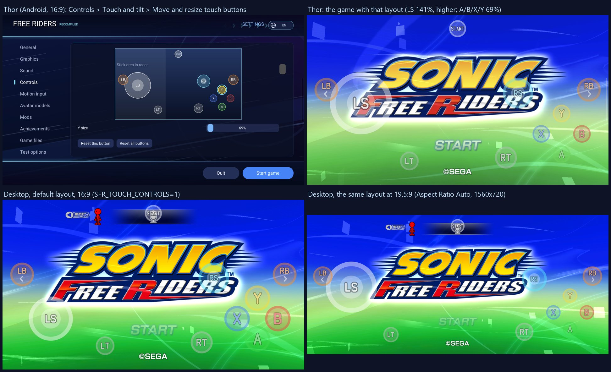

# Android 版

遊戲本體與桌面版共用同一份產生碼與執行期，打包成 APK：SDL 2.32.8 的 Java activity 載入
`libSDL2.so` 與遊戲的 `libmain.so`，繪圖用 [Vulkan 後端](vulkan.md)，輸入與聲音走 SDL2
（與 [Linux 版](linux.md) 相同）。

## 需要的東西

- Android SDK（build-tools、platform 35 以上）、NDK（驗證用 29.0.13599879）、JDK 17。
  `ANDROID_HOME` 未設定時使用 `~/AppData/Local/Android/Sdk`（Windows）或 `~/Android/Sdk`。
- `python scripts/bootstrap.py` 取得固定版本的 SDL（`tools/SDL`），並套用 `patches/` 中的
  Plume 修正。
- 產生碼（README 的步驟）。

## 建置

```bash
scripts/build_android.sh
```

逐一建置 `arm64-v8a` 與 `x86_64`（`--abi` 可只選一個），再由 `scripts/package_android.py`
用 SDK 自己的 aapt2、javac、d8、zipalign、apksigner 打包成
`out/android/FreeRidersRecompiled.apk`，並以本機 debug 金鑰簽署。整個過程不經過 Gradle，
不下載任何東西。

## 啟動器

App 一打開是啟動器（`LauncherActivity`，與桌面版同一套頁面，`src/launcher_main.cpp`）：

- **安裝**：「選擇光碟映像檔...」開啟系統的檔案選擇器，選手機上的 Sonic Free Riders `.iso`
  （美版／歐版），啟動器檢查後把光碟檔案複製到 app 的儲存空間，並解碼遊戲程式。需要約 2 GB
  可用空間（光碟檔案 1.7 GB 加上遊戲程式）；安裝完成後映像檔可以刪除。Android 不能選資料夾。
- **著色器包**：「遊戲檔案」分類的「選擇 shaders.pack...」從檔案選擇器複製進來。
- **設定**：音效、略過影片、略過標誌畫面、觸控按鈕、傾斜轉彎等；視窗大小與全螢幕在手機上不適用，
  不顯示。
- **開始遊戲**：啟動器寫入 `settings.env`，在另一個行程（`:game`）開啟 `GameActivity`。
  遊戲中按返回鍵是遊戲的 B（返回）；**長按返回鍵**結束遊戲，回到啟動器。遊戲自行停止時，
  啟動器顯示 `game.log` 的最後幾行。

選到的檔案一律透過檔案選擇器交給 app 的描述元讀取（`/proc/self/fd/N`，用 `dup` 與 `pread`），
不會用路徑重新開啟：重新開啟會回到儲存空間的提供者，而 app 本身沒有權限，讀取會失敗
（先前「找不到 default.xex」就是這個原因）。

中文字型：Android 的中日韓字型是 ImGui 讀不了的可變 CFF2 字型，所以啟動器請 Android 自己
畫出介面用到的幾百個中文字（`LauncherActivity.renderGlyphs`），放進 ImGui 的字型圖集。

## 遊戲檔案

遊戲檔案放在 app 的外部檔案目錄 `/sdcard/Android/data/com.freeriders.recompiled/files`
（啟動器安裝的位置；也可以用 adb 直接放進去）：

| 路徑 | 內容 |
| --- | --- |
| `game/image` | 解碼後的遊戲程式（桌面安裝器的 `game/image`，或 `out/recomp/image-loader`） |
| `game/assets` | 光碟檔案（`game/assets` 或 `private/assets`） |
| `shaders.pack` | 編好的著色器（`python scripts/pack_shaders.py`）；裝置上沒有翻譯器 |
| `settings.env` | 啟動器每次開始遊戲時寫入的執行期設定（每行 `NAME=VALUE`） |
| `game.log` | 執行期的追蹤輸出，每次啟動重寫 |
| `save/` | 存檔（[存檔](saves.md)） |

```bash
adb install -r out/android/FreeRidersRecompiled.apk
adb shell mkdir -p /sdcard/Android/data/com.freeriders.recompiled/files/game
adb push out/recomp/image-loader/. /sdcard/Android/data/com.freeriders.recompiled/files/game/image/
adb push private/assets/. /sdcard/Android/data/com.freeriders.recompiled/files/game/assets/
adb push out/shaders/shaders.pack /sdcard/Android/data/com.freeriders.recompiled/files/
adb shell chmod -R a+rwX /sdcard/Android/data/com.freeriders.recompiled/files
```

用 adb 放檔案時，最後一行讓 app 能讀取它們（它們屬於 shell 使用者）。解除安裝 app 會一併
刪除這個目錄。

## 與桌面版不同的部分

- 執行期在載入 `libmain.so` 時（靜態初始化）就讀取環境變數，所以 `GameActivity` 在載入
  函式庫之前先把 `settings.env` 與遊玩預設值放進環境；`SDL_main`（`src/android_main.cpp`）
  再切換工作目錄、把 stderr 導到 `game.log`，然後呼叫一般的 `main`。
- Plume 在 Android 上直接畫到視窗的 `ANativeWindow`；交換鏈是 RGBA（Android 的表面不提供
  BGRA）。App 在背景時 SDL 暫停事件迴圈（遊戲跟著停住），回到前景時視窗換了新的表面，
  交換鏈在它上面重建；取得或呈現影像失敗時也會重建，並略過那一格。
- NDK 的 libc++ 仍把 `std::jthread`／`std::stop_token` 放在實驗功能，需要
  `-fexperimental-library`。bionic 沒有 `pthread_setaffinity_np`，改用 `sched_setaffinity`。
- `patches/plume-optional-extensions.patch`：`VK_EXT_robustness2` 與
  `VK_KHR_sampler_mirror_clamp_to_edge` 改為選用（模擬器與部分手機驅動沒有），並修正沒有
  null descriptor 時關閉裝置的崩潰。bootstrap 只接受 Plume 上恰好是這些修改。

## 觸控操作

沒有手把時，畫面上有半透明的觸控按鈕（`src/touch_controls.*`，由最後的 blit 著色器畫在遊戲
畫面上；`SFR_TOUCH_CONTROLS=0` 或啟動器的「觸控按鈕」關閉）。iOS 版也預設開啟（Issue #236）。

每個按鈕上寫著 Xbox 手把的名稱（Issue #236）：A、B、X、Y、RT、LT、LB、RB、START，兩個搖桿的
搖桿頭上是 LS、RS。字用按鈕顏色的淺色加暗邊，不用字型：每個字母是幾筆圓頭直線
（`src/touch_labels.cpp`），產生成 `src/shaders/touch_labels.hlsli` 的常數，在 blit 裡算到筆畫的
距離。改字形後執行 `sfr_touch_labels_test --write src/shaders/touch_labels.hlsli`；測試會檢查
檔案沒有過時、字在按鈕內、字母互不相連、720p 時字高至少 12 像素。

啟動器「畫面與效能」的「顯示 FPS」（`SFR_FPS_OVERLAY=1`，預設關，所有平台）在遊戲畫面左上角
顯示每半秒更新的呈現幀率（`src/fps_readout.*`），用同一套筆畫字形由 blit 畫出，數值放在
push constant 的最後一個字。手機沒有視窗標題，所以這是看幀率的方法；桌面的視窗標題統計照舊。

App 圖示（Issue #236）：和 iOS／macOS／Windows 同一張 `packaging/icon/app.png`，
`scripts/package_android.py` 打包時放進 APK 當 `@mipmap/ic_launcher_art`，adaptive icon 的前景
內縮到 74 dp，各種遮罩只會切到四角。minSdk 28，所以不需要舊式 mipmap。

| 位置 | 按鈕 | 用途 |
| --- | --- | --- |
| 比賽中左側 40% 任意處；比賽外只在搖桿的圓圈上 | 浮動搖桿 | 選單中推過一半是十字鍵（每推一次一格）；比賽中是左類比（傾斜轉彎） |
| 右側菱形下／右／左／上 | A（綠）／B（紅）／X（藍）／Y（黃） | 確定、蹲下跳躍；返回、煞車；踢地加速；站姿 |
| X 的左下 | RT（灰） | 使用、搖晃道具 |
| 上方中央 | START（白） | 開始；比賽中暫停 |
| 左／右邊緣中段 | LB／RB（橘，箭頭指向該側） | Power Skill：往左／右出拳 |
| 菱形左上方 | 右類比（青，固定位置） | 比賽中伸手：左右推是往該側伸手拿 Ring（推越多伸越遠），往上是舉起雙手；按住 RT 時擦螢幕。選單中移動手部游標 |
| 下方、搖桿右側 | LT（灰） | 牽手（Tag Race） |

比賽中也可以把手機當方向盤左右傾斜來轉彎（加速度計，5° 以下不動、25° 轉到底；
`SFR_TILT=0` 關閉），按住搖桿時以搖桿為準。
啟動器「控制 › 觸控」的「傾斜踢地加速」（`SFR_TILT_LEAN`，預設關閉；Issue #247，最早叫「傾斜前後傾」、
送左類比上下，但比賽只把它用在特技，所以改成回報者選的踢地加速）：手機上緣往外傾（螢幕朝天）
超過約 17°（從中立算起）就按一下 X（踢地加速，約 0.15 秒）；要傾回 10° 以內才會再踢，所以一直傾著只踢一次。
往自己傾不做事。手機的拿法因人而異，所以比賽開始時（或開始讀到橫向的傾角時）的角度就是中立，
在 5° 以內約一秒、超過時約半分鐘慢慢跟上新的拿法。按住 A（蹲下準備跳）時與放開後 0.5 秒內不踢。
傾斜不再動左類比上下，所以不會變成空中技巧。選單中搖桿不送出類比值，因為那會移動模擬的
Kinect 左手，懸停時會誤選按鈕。右類比則從自己的圓圈開始按才會抓住，之後手指移到別的按鈕上也不會按下它們。

**用手指操作手部游標（Issue #217）**：比賽以外，按在按鈕以外的地方，Kinect 的手部游標就移到
手指下並跟著手指移動；放開後游標留在原處，和真的 Kinect 一樣停留一下就選取。所以「點一下」＝
游標移過去、停住、選取。環狀選單點項目後會出現 → 按鈕，再點它確定。選取造成換頁或開關對話框時，
如果手指已經放開，游標會回到左上角（等待游標的位置），免得停在原處又選到下一頁同位置的按鈕。
**標題畫面**（以及開頭的 SEGA、Sonic Team 標誌）按任何不是按鈕的地方等於 START。細節與量測見
[touch-cursor.md](touch-cursor.md)。

**自訂觸控按鈕（Issue #443）**：啟動器「控制 › 觸控與傾斜」最下面的「自訂觸控按鈕」（預設收合）
每個按鈕一列、兩個開關：「顯示」關掉就整個隱藏那個按鈕（不畫、也不讀觸控），「名稱」關掉只拿掉
上面的字（LB／RB 連箭頭一起）。上方「按鈕名稱」仍是一次關掉全部名稱，關閉時每列的「名稱」開關
變灰。隱藏的按鈕那一塊就是空白畫面：比賽中左側 40% 的空白處本來就是浮動搖桿（所以隱藏 LB、LT
後那裡會叫出搖桿，除非搖桿也隱藏），右側則沒反應；選單中是手部游標、標題畫面是 START；
劇情與影片本來就不畫按鈕，按任何地方照樣是按住 START。只用傾斜轉彎的人可以隱藏搖桿（LS），
傾斜在沒有按住搖桿時本來就會轉彎。設定存在 `settings.ini` 的 `touch_hidden=`、`touch_unnamed=`，
值是按鈕名稱清單（`ls,a,b,x,y,rt,start,lb,rb,lt,rs` 的子集，例如 `touch_hidden=ls,lt`），
啟動時交給遊戲當 `SFR_TOUCH_HIDDEN`、`SFR_TOUCH_UNNAMED`（`src/touch_options.h`；空的就不設，
全部顯示）。用名稱而不是位置，之後的位置與大小編輯器可以用同一組名稱。blit 收到的圓圈狀態是
負的（-1、-2）就不畫名稱。

**移動與縮放觸控按鈕（Issue #443）**：同一頁下面的「移動與縮放觸控按鈕」（預設收合）是一張遊戲畫面
的預覽，形狀跟遊戲一樣（「畫面比例」是自動就用螢幕的形狀，否則 16:9），上面畫著顯示中的按鈕（顏色
與遊戲相同，隱藏的不畫）。手指拖曳按鈕就移動它；點一下是選取（拖超過幾個像素才算移動），選取後下方
有大小滑桿（預設的 50%～200%，但半徑不小於畫面高度的 1/20，也就是 START 的大小，所以 A／B／X／Y
最小 67%、LT 91%、START 不能縮小）、「重設這個按鈕」與「全部重設」。拖曳時頁面不會跟著捲動。按鈕疊在一起時，
再點一次同一處會改選下一個，被蓋住的按鈕也選得到。



- **存法**：`settings.ini` 的 `touch_layout=`，每個改過的按鈕一筆，用 `;` 分開：
  `名稱:錨點位移,y,大小`，例如 `touch_layout=ls:l0.320,0.550,1.40;a:r0.276,0.820,0.80`。
  名稱同 `touch_hidden`；錨點 `l`／`r`／`c` 是從左邊、右邊、畫面中央量，位移的單位是「畫面高度」
  （`l`、`r` 往內為正，`c` 往右為正）；y 是圓心高度（0 頂、1 底）；大小是預設半徑的倍數。
  編輯器放下按鈕時選三者中最近的那個。這跟 PR #444 的預設配置一樣（每個按鈕保持與較近側邊的距離），
  所以在 20:9 手機上排好的配置拿到 16:9 平板上，兩手的按鈕仍各在兩側、START 仍在中間。沒列出的按鈕
  用預設位置與大小；空的就是原本的配置。啟動時交給遊戲當 `SFR_TOUCH_LAYOUT`（`src/touch_layout.h`；
  空的就不設），遊戲讀到非空的配置會在 `game.log` 印 `TOUCH layout ...`。數字自己讀寫（不經 C 函式庫），
  不受地區設定的小數逗號影響；看不懂的項目略過。
- **限制**：不管放在哪，圓圈都整個留在畫面內；大小限制同上。
- **觸控跟著走**：畫的、按的（含按鈕外 1.25 倍半徑的寬容範圍）、搖桿的行程（半徑）都用新的位置與大小。
  比賽中的浮動搖桿區：LS 在左半邊時是左側 40%（LS 放到 40% 以外時延伸到它的圓）；LS 放到右半邊，
  搖桿區就換到右側 40%。搖桿靜止時畫在 LS 放的位置；浮動搖桿的底座仍出現在手指落下的地方。
- **重疊**由玩家決定，判定順序固定：先看按鈕（A、B、X、Y、RT、START、LB、RB、LT）——跟以前一樣，
  手指所在的圓或圓外寬容範圍涵蓋到的按鈕都按（像拇指同時壓兩顆）；但手指同時在兩個以上的圓「裡面」時
  而且其中至少一個是玩家移動或縮放過的，只按離圓心最近（以各自半徑計）的那一個（預設的圓在比 16:9
  窄的畫面上可能相交，例如 LT 與 RT，那時照舊一起按）；
  接著是右搖桿、左搖桿（選單中是它的圓、比賽中是它那一側），最後才是選單的手部游標或標題的 START。
  所以預設配置在任何比例下的判定都與以前完全相同（測試在 16:9、19.5:9、20:9、5:4 逐點比對）。
- 編輯器在啟動器裡，不碰遊戲迴圈；縮放用滑桿，不支援雙指縮放（ImGui 只有一個指標）。

LB／RB 放在左右兩側，是因為比賽畫面左上（Ring、道具）、左下（名次、圈數）、右上（地圖）、右下
（空氣量、速度）都有 HUD，兩側中段是空的（Issue #177）。

## 驗證與限制

在 Android 16 模擬器（x86_64，gfxstream Vulkan）上，遊戲從啟動跑到標題畫面，畫面與聲音正常；
第一次執行建立存檔；用觸控從標題進入主選單、Offline Mode 並轉動選單；切到主畫面再回來後繼續執行。模擬器本身在遊戲執行
幾分鐘後偶爾會整個結束（主機端 gfxstream，Android 內沒有錯誤紀錄）。arm64 版可以建置，但還
沒有在實機上執行。已知限制：

- 傾斜轉彎的方向是依裝置座標推算的，還沒有在實機上確認左右是否正確。
- 只能用 `shaders.pack` 裡的著色器。遊戲開機時就建立全部 468 個著色器（六條賽道與 Grand
  Prix 劇情都沒有出現新的），所以一次開機收集的包就是完整的；APK 內附一份。
- 頁面大小 16 KB 的新款裝置尚未驗證（客體記憶體以 4 KB 為單位對應）。
