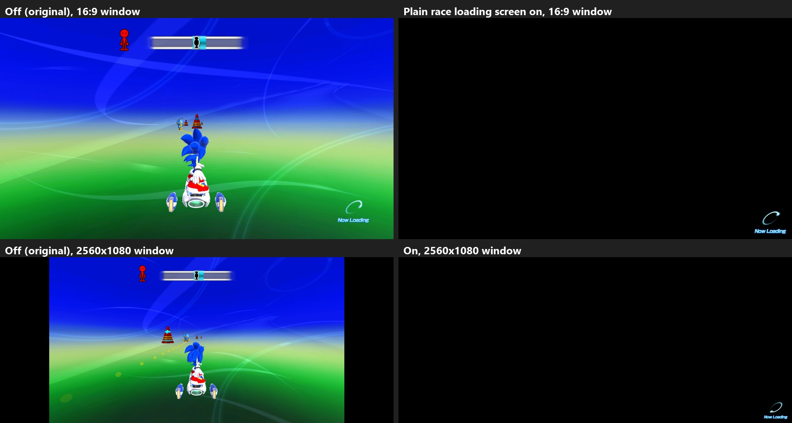

# Plain race loading screen

Before every race the title loads the course behind a practice screen made
for Kinect: Omochao asks the player to stand on their gear, measures their
body, and lets them ride a practice track with cones while "Now Loading"
turns in the corner. Without a Kinect it only shows the racer riding by
itself. The launcher option **General › Gameplay › Plain race loading
screen** (Issue #365, item 8; `SFR_PLAIN_RACE_LOADING=1`) shows that time as
a black screen with only Now Loading, moved into the corner. It is off by
default, and it works the same with or without a Kinect or camera.

## The loading screen in the title

- When a race is chosen, the race scene is built (its constructor
  `82247138` raises the race flag `[83E52F8C]`) and a practice object is put
  in `[83E52F48]`. Every frame, before the task manager, the frame function
  updates it (`8223A578`) and draws it (`8223A870`) until its `+4` is 4;
  then it is finished (`822394E0`) and deleted, and the race's own frames
  follow (`82211D10`..`82211D94`).
- The practice object's update steps through `+0x10` (0 creates its two
  parts, 1 waits for its own files, 2 waits for the race scene, 3 runs) and,
  while it runs, through the practice phases in `+0xC` (`82239EA8`: the body
  measurement, the practice, waiting for the race's files, fading out). Its
  two parts draw the sky and ground (`[+0x4C]`, vtable `82198C08`, draw
  `8223DAA8`) and Omochao with the cones (`[+0x50]`, vtable `82198AC0`, draw
  `82238580`).
- Beside it, tasks of the task manager draw the rest: the player's racer
  (`821A1920`), which rides the practice track, the speech balloon
  (`82198C6C`), the body gauge (`821A87E8`), the Kinect figure (`821A737C`)
  and Now Loading (`82198C18`, draw `8223DFE8`: a ring and the words, two
  textured quads through `8223CE58`, until its `+0x6C` says the files are
  loaded).

## What the option changes

Nothing of the above stops running. The practice decides when the race
starts, and several of its drawing functions write state that its update
reads (`82238580` stores into its object, `8223A870` advances the state of
the object at `[83E53148]`), so leaving them out could change the race's
start. Instead, while the screen is up (the practice object exists and the
race flag is set):

- every draw call is left out where the renderer receives it
  (`native_draw`), except those made inside Now Loading's draw. No quad is
  drawn over anything: the frame keeps the black it was cleared to;
- Now Loading's ring and words move 60 pixels right and 36 down in the
  1280x720 layout, so the words end about 20 pixels from the right and
  bottom edges. The ring is placed by a matrix passed on the stack (the
  caller's `r1+0x54`), the words by the quad's corners (`f1`..`f4`);
- the presentation shows the frame in the window's bottom right corner
  instead of its centre (`NativePresentation::set_corner_anchor`). The title
  draws its loading screens into an 880x720 back buffer that is shown as
  16:9; on a wider window that 16:9 area now touches the window's right
  edge, so Now Loading sits in the window's corner and the rest is black.

The loading itself, the practice's timing and the race are the same as with
the option off. The pad's body measurement is still skipped the same way
(`NUI_RACE_PREPARATION`, `nui_race_hooks.cpp`), and no button has to be
pressed to leave the screen.

## Verification

Windows, Vulkan, the Free Race route of the release harness (Dolphin
Resort, Sonic, from an empty save), `SFR_TEST_RAND_SEED=1` and
`SFR_RACE_TRACK=10`, two runs with the option off and two with it on:

| Run | Screen up / gone (present) | 12 racers (present) | Race steps from the first practice step |
| --- | --- | --- | --- |
| off | | 15333 | 980 |
| off | | 15330 | 980 |
| on | 14332 / 15317 | 15324 | 980 |
| on | 14332 / 15323 | 15330 | 980 |

Every racer's position is the same in all four runs for the race's first
180 steps (3 seconds); after that the four runs differ from each other by
the same amounts, off against off as much as off against on (the computers'
own run-to-run differences). The race files finish loading about 11 seconds
into the screen (Now Loading goes); the screen ends about 5 seconds later,
when the practice has faded out, in every run. The option does not shorten
that.

World Grand Prix, from an empty save (Team Heroes, mission 1, a one-lap
race at Dolphin Resort, after the opening story scene), one run off and
one on: the screen was black with Now Loading from present 6983 to 7985, the
mission card followed, and all 12 racers were on the course 1020 race steps after
the first practice step in both runs (present 8028 off, 8032 on). Retrying
the mission after a lost race does not load again, so it shows no loading
screen either way.

With a 2560x1080 window, Now Loading sits in the window's bottom right
corner with the option on (the lower pair of the picture above, captured
from the window).
