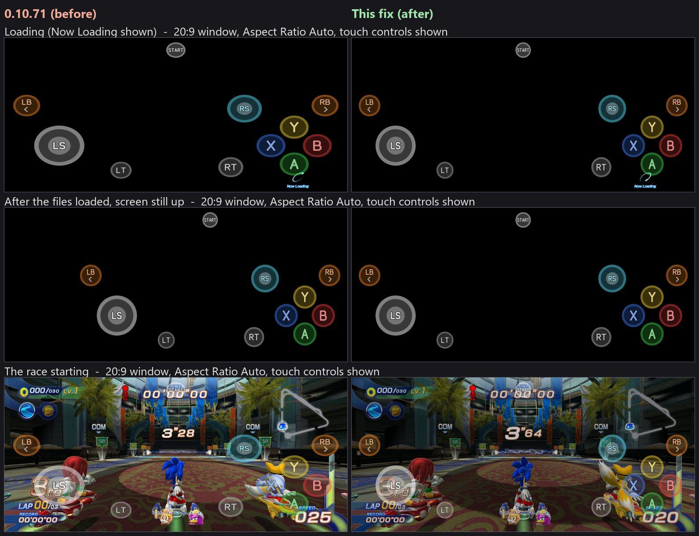

# Plain race loading screen

Before every race the title loads the course behind a practice screen made
for Kinect: Omochao asks the player to stand on their gear, measures their
body, and lets them ride a practice track with cones while "Now Loading"
turns in the corner. Without a Kinect it only shows the racer riding by
itself. The launcher option **General › Gameplay › Plain race loading
screen** (Issue #365, item 8; `SFR_PLAIN_RACE_LOADING=1`) shows that time as
a black screen with only Now Loading, moved into the corner. It is off by
default, and it works the same with or without a Kinect or camera.

## The loading screen in the title

- When a race is chosen, the race scene is built (its constructor
  `82247138` raises the race flag `[83E52F8C]`) and a practice object is put
  in `[83E52F48]`. Every frame, before the task manager, the frame function
  updates it (`8223A578`) and draws it (`8223A870`) until its `+4` is 4;
  then it is finished (`822394E0`) and deleted, and the race's own frames
  follow (`82211D10`..`82211D94`).
- The practice object's update steps through `+0x10` (0 creates its two
  parts, 1 waits for its own files, 2 waits for the race scene, 3 runs) and,
  while it runs, through the practice phases in `+0xC` (`82239EA8`: the body
  measurement, the practice, waiting for the race's files, fading out). Its
  two parts draw the sky and ground (`[+0x4C]`, vtable `82198C08`, draw
  `8223DAA8`) and Omochao with the cones (`[+0x50]`, vtable `82198AC0`, draw
  `82238580`).
- Beside it, tasks of the task manager draw the rest: the player's racer
  (`821A1920`), which rides the practice track, the speech balloon
  (`82198C6C`), the body gauge (`821A87E8`), the Kinect figure (`821A737C`)
  and Now Loading (`82198C18`, draw `8223DFE8`: a ring and the words, two
  textured quads through `8223CE58`, until its `+0x6C` says the files are
  loaded).

## What the option changes

Nothing of the above stops running. The practice decides when the race
starts, and several of its drawing functions write state that its update
reads (`82238580` stores into its object, `8223A870` advances the state of
the object at `[83E53148]`), so leaving them out could change the race's
start. Instead, while the screen is up (the practice object exists and the
race flag is set):

- every draw call is left out where the renderer receives it
  (`native_draw`), except those made inside Now Loading's draw. No quad is
  drawn over anything: the frame keeps the black it was cleared to;
- Now Loading's ring and words move 60 pixels right and 36 down in the
  1280x720 layout, so the words end about 20 pixels from the right and
  bottom edges. The ring is placed by a matrix passed on the stack (the
  caller's `r1+0x54`), the words by the quad's corners (`f1`..`f4`);
- a frame in which Now Loading was drawn is shown in the window's bottom
  right corner instead of its centre (`NativePresentation::set_corner_anchor`,
  `plain_race_loading.h`). With Aspect Ratio Original the title draws into a
  16:9 framebuffer; on a wider window that 16:9 area then touches the
  window's right edge, so Now Loading sits in the window's corner and the
  rest is black. Once the files are loaded Now Loading goes and the rest of
  the screen is centred as usual. With Aspect Ratio Auto the framebuffer
  already has the window's shape, so nothing moves; Now Loading then sits in
  the corner of the centred 16:9 area the title keeps its 2D in (about 175
  pixels from the right edge of a 1560x702 window), with the option off as
  with it on;
- the title's 16:9 views that a wider framebuffer would show as centred 16:9
  (`GuestGraphics::present_front_buffer`) take the whole frame instead when
  they are black (no Now Loading drawn in them), and the window stays filled
  from the screen to the race. One with Now Loading keeps 16:9, so its words
  and ring are not widened, and goes to the corner;
- every sound the practice asks the title's sound manager for (`8222FA18`:
  player, sound) is asked for as the title's own "no sound", `-1`. The music
  has its own path (`82230250`) and is not touched;
- the player's controllers, keyboard and touch controls read as at rest
  (`set_loading_input_held`, `native_input.cpp`).

The loading itself, the practice's timing and the race are the same as with
the option off and no input. The pad's body measurement is still skipped the
same way (`NUI_RACE_PREPARATION`, `nui_race_hooks.cpp`), and no button has
to be pressed to leave the screen.

## Follow-up: a wide phone, sounds and input (0.10.72)

(The oval touch controls in the left column are 0.10.71's own; PR #444 made
them round.)

Joka2010 tried 0.10.71 on a Pixel 10a (2424x1080, about 20:9, Aspect Ratio
Auto, the picture filling the screen) and reported three things. Each was
reproduced on Windows first, with the 0.10.71 package in a 1560x702 window
(`SFR_ASPECT_MODE=auto`, `SFR_TOUCH_CONTROLS=1` to show where the frame is),
on the Free Race route below, and captured from the window itself.

- **"It chopped the window in half" when the loading finished.** With Auto
  the framebuffer is 1600x720. While the files load, the title draws the
  screen into its 880x720 back buffer, which is stretched over the whole
  frame, so Now Loading was in the corner and the frame filled the window.
  When the files are loaded (Now Loading goes) the practice goes on, for
  about 12 more seconds in that run, drawing into a 1280x720 view in the left
  of the framebuffer. Such views are shown as 16:9, and the corner anchor was
  on for the whole screen, so that black 16:9 frame went against the right
  edge: the touch controls and the frame-rate readout, drawn in the shown
  frame, jumped into the right three quarters of the screen until the race
  (the middle pair of the picture above; the reporter's second screenshot
  shows the same). The anchor is now only on for frames that show Now
  Loading, and the screen's 16:9 views fill the frame.
- **The practice's sounds still played.** With `SFR_AUDIO_CUES=1` every sound
  the screen asked for came through `8222FA18`: Omochao's lines (200000,
  200003 and others) and the practice's effects (100000), on players 19 to
  23, which are the practice's. The race's first sounds (401013 on players
  295 and 296, 200000 on 173, the racers' 1000xx) are asked for in the frame
  the practice object is deleted, after it, so the screen's test (the object
  exists) already says no. The music goes through `82230250`, which no
  loading screen called: there is no loading music to keep. While the screen
  is up the sound asked for becomes `-1`. Players 19 and 23 then ask again
  every frame (they keep a sound going), which costs a lock each; the line
  of 200003 is asked for twice, as before. The output's own recording
  (`SFR_AUDIO_DUMP`) is digital silence for the whole screen, and the race's
  sounds follow at once. Muting the output instead would also have muted
  anything else, and leaving the calls out could have changed what the
  practice waits for; the title's own "no sound" changes neither.
- **The practice still took input.** The racer on the practice track rides
  from the pad (through the body the pad stands in for), and doing the moves
  makes the practice go faster: with 0.10.71, the same route with A, the
  stick, X and B pressed during the screen ended it at present 15284 and
  started the race 950 steps after the first practice step, against 15307
  and 980 without input, and Omochao said other lines. Nothing of that is
  shown, so the controllers, the keyboard and the touch controls (and the
  phone's tilt, which reaches the game the same way) now read as at rest
  while the screen is up; user 0 stays connected. That is the same hold the
  Kinect adjustment window uses, kept apart so neither lets go of the other.
  A Kinect or camera body is not held: its measurement is part of the
  practice.

## Verification

Windows, Vulkan, the Free Race route of the release harness (Dolphin
Resort, Sonic, from an empty save), `SFR_TEST_RAND_SEED=1` and
`SFR_RACE_TRACK=10`, two runs with the option off and two with it on:

| Run | Screen up / gone (present) | 12 racers (present) | Race steps from the first practice step |
| --- | --- | --- | --- |
| off | | 15333 | 980 |
| off | | 15330 | 980 |
| on | 14332 / 15317 | 15324 | 980 |
| on | 14332 / 15323 | 15330 | 980 |

Every racer's position is the same in all four runs for the race's first
180 steps (3 seconds); after that the four runs differ from each other by
the same amounts, off against off as much as off against on (the computers'
own run-to-run differences). The race files finish loading about 11 seconds
into the screen (Now Loading goes); the screen ends about 5 seconds later,
when the practice has faded out, in every run. The option does not shorten
that.

World Grand Prix, from an empty save (Team Heroes, mission 1, a one-lap
race at Dolphin Resort, after the opening story scene), one run off and
one on: the screen was black with Now Loading from present 6983 to 7985, the
mission card followed, and all 12 racers were on the course 1020 race steps after
the first practice step in both runs (present 8028 off, 8032 on). Retrying
the mission after a lost race does not load again, so it shows no loading
screen either way.

With a 2560x1080 window, Now Loading sits in the window's bottom right
corner with the option on (the lower pair of the first picture, captured
from the window).

### The follow-up (0.10.72)

The same route and settings, this branch's build, the window captured every
half second while the screen was up and every tenth of a second after it,
`SFR_TOUCH_CONTROLS=1` so that the shown frame can be seen:

| Run | Window | Input during the screen | Screen up / gone (present) | Race steps from the first practice step |
| --- | --- | --- | --- | --- |
| 0.10.71 | 1560x702 (20:9), Auto | none | 14332 / 15307 | 980 |
| 0.10.71 | 1280x720, Original | A, stick, X, B | 14332 / 15284 | 950 |
| branch | 1560x702 (20:9), Auto | A, stick, X, B | 14332 / 15308 | 980 |
| branch | 1560x702 (20:9), Auto | none | 14332 / 15307 | 980 |
| branch | 1680x720 (21:9), Auto | none | 14332 / 15308 | 980 |
| branch | 1280x720 (16:9), Auto | none | 14332 / 15308 | 980 |
| branch | 2560x1080, Original | none | 14332 / 15307 | 980 |
| branch, option off | 1560x702 (20:9), Auto | none | | 980 |

- 0.10.71 at 20:9: from the moment Now Loading went until the race, every
  capture had the touch controls in the right part of the window.
- The branch at 20:9 and 21:9: every capture of the screen has the touch
  controls where they are in the race, and the race's first frames fill the
  window. At 16:9 nothing moves either way.
- The branch at 2560x1080 with Original: the frames with Now Loading are in
  the window's bottom right corner; after it the black screen and the race
  are centred.
- Sound: the branch's runs asked for no sound while the screen was up, and
  its output recording is silent from the screen's start to the race's
  first sounds. With the option off the same stretch holds the practice's
  sounds (about -33 dBFS, Omochao's lines above that) and no music.

