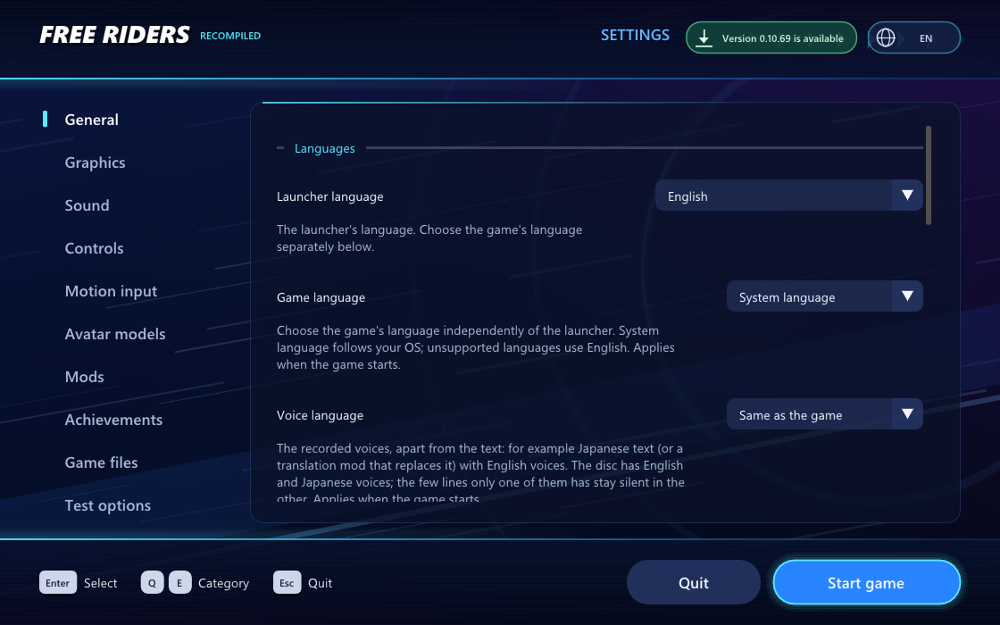

# Update notice

The launcher tells the player when a newer release is out (Issue #365, item
12). It only points the browser at the release's file; it never downloads or
installs anything itself.



## What it does

1. At most once an hour, on the launcher's first frame (and again once the
   hour is over, if the launcher stays open; it looks once a minute), a
   background thread sends one
   `GET https://api.github.com/repos/YuutaTsubasa/Free-Riders-Recompiled/releases/latest`.
   GitHub's `latest` already skips drafts and prereleases; the launcher also
   ignores any tag that is not `vX.Y.Z` (such as the `deps-onnxruntime-1.30.0`
   mirror of a build dependency). Should the latest release ever be such a
   tag, a second request reads the recent releases
   (`/releases?per_page=20`) and takes the newest `vX.Y.Z` among them that is
   neither a draft nor a prerelease.
2. It compares that version with its own, number by number (0.10.10 is newer
   than 0.10.9).
3. When the release is newer, a green **Version X is available** button
   appears in the top bar, left of the language button, on every page but the
   installer's progress. The same notice, with a **Download** button keys and
   pads can reach, is in **General › Updates**.
4. The button opens, in the browser, the release's file for this system:

   | Launcher | File |
   | --- | --- |
   | Windows (x64, and ARM64 through emulation) | `FreeRidersRecompiled-X-windows-x64.zip` |
   | Linux x86-64 | `FreeRidersRecompiled-X-linux-x64.tar.gz` |
   | Android arm64, the API 29 build | `FreeRidersRecompiled-X-android10-arm64.apk` |
   | Android arm64, the API 28 build | `FreeRidersRecompiled-X-android-arm64.apk` |
   | macOS on Apple silicon | `FreeRidersRecompiled-X-macos-arm64.zip` |
   | iOS | `FreeRidersRecompiled-X-ios-arm64.ipa` |

   Android picks by the build's own minimum API level (`__ANDROID_API__`, set
   by `SFR_ANDROID_API` in `scripts/build_android.sh`), so a player keeps the
   flavour they installed. A system the releases have no file for (Linux on
   ARM, an Intel Mac, Android x86-64), or a release missing that file, opens
   the release's page instead. Only addresses under
   `https://github.com/YuutaTsubasa/Free-Riders-Recompiled/` are opened.

## Privacy

The request carries no personal data: no account, no token, no cookies, and
a User-Agent of `FreeRidersRecompiled-launcher/<version>` only. GitHub sees
the IP address, as with any visit. Each platform uses its own HTTP client,
with no cookie store:

| Platform | Client |
| --- | --- |
| Windows | WinHTTP (cookies disabled), the system's proxy settings |
| Android | `HttpURLConnection` in `LauncherActivity.fetchBytes`, called through JNI |
| macOS, iOS | `NSURLSession` with an ephemeral configuration (`src/launcher_https_apple.mm`) |
| Linux | the system's `libcurl.so.4` (or `libcurl-gnutls.so.4`), opened at run time |

The launcher does not link libcurl: a Linux system without it simply has no
update check, and nothing else changes.

## Never in the way

- At most once an hour: the time of the last check, the version found and its
  file's address are kept in `settings.ini` (`update_checked_at`,
  `update_version`, `update_url`). A failed check also waits until the next
  hour, so a launcher without a network does not try at every start. A clock
  set back makes it ask again.
- GitHub allows 60 unauthenticated API requests an hour per IP address. A
  check is one request (two in the rare case the latest release is not a
  `vX.Y.Z` tag and `/releases?per_page=20` is read too), so one check an hour
  per launcher stays well inside it, even with a few launchers behind the
  same address. Over the limit GitHub answers 403, which is a `no_answer`
  that waits for the next hour like any other failure.
- Each step times out after 5 seconds and a failure is silent. **Start game**
  never waits for the check.
- **General › Updates › Check for updates** (`check_updates`, on by default)
  turned off sends nothing and hides the notice. **Restore defaults** keeps
  the last answer (it is not a setting).

The launcher prints what happened on its standard error, for example:

```text
LAUNCHER_UPDATE_CHECK outcome=found current=0.10.69 latest=0.10.69 newer=0 url=https://github.com/.../FreeRidersRecompiled-0.10.69-windows-x64.zip
LAUNCHER_UPDATE_CHECK skipped=checked_recently current=0.10.69 latest=0.10.69 newer=0
LAUNCHER_UPDATE_CHECK skipped=off current=0.10.69
LAUNCHER_UPDATE_OPEN url=...
```

`outcome` is `found`, `no_answer` (no network, a timeout, a status other than
200, GitHub's rate limit), `unreadable` or `not_a_release`.

## The build's version

The launcher's version is `VERSION_NAME` in `scripts/package_android.py`, the
one place a release bumps it. CMake reads it and compiles it into
`src/update_check.cpp` alone (so a bump rebuilds one file), and configures
again when that file changes. `scripts/package_release.py` checks that every
launcher it packages carries the release's version (see
[releasing.md](releasing.md)).

## Testing

`tests/update_check_test.cpp` (ctest `update_check`) covers version
comparison, tag filtering, reading GitHub's answer, the file chosen per
platform and Android flavour, the once-an-hour rule and a whole check against a
made-up answer. To see the notice on a real launcher, a test-only variable
stands in for the build's version:

```powershell
$env:SFR_TEST_UPDATE_CURRENT_VERSION = '0.10.60'
```

Delete `update_checked_at` from `settings.ini` to make the launcher ask again
within the hour. Players never need either.
